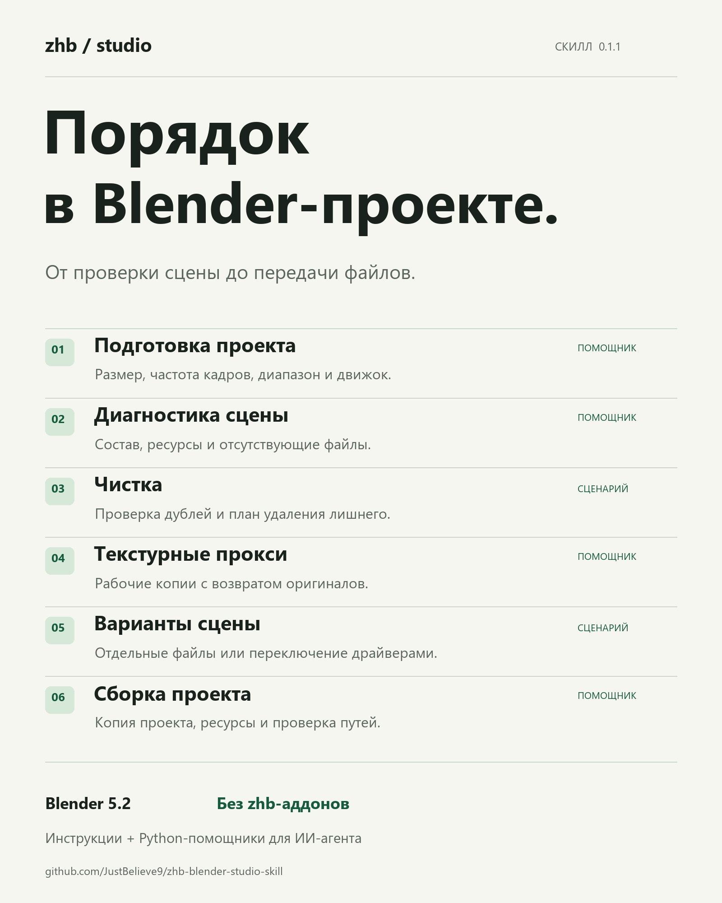

# ZHB Studio

**Приведите Blender-проект в порядок и подготовьте его к передаче — вместе с ИИ-агентом.**

[Скачать скилл](https://github.com/JustBelieve9/zhb-blender-studio-skill/releases/latest) · [Карта возможностей](zhb-blender-studio/references/features.md) · [Проверки](docs/VALIDATION.md) · [Постер SVG](media/poster.svg)

ZHB Studio даёт агенту рабочие сценарии подготовки, диагностики, оптимизации и
сборки проекта. Внутри — инструкции и Python-помощники для Blender. Никаких
личных путей, обязательного формата кадра или зависимости от zhb-аддонов.

Это **скилл для агента**, а не расширение Blender с кнопками. Для выполнения
операций агенту нужен доступ к Blender через командную строку или инструмент
запуска Python в открытой сессии.

## Что вы получаете

Скилл собирает повторяющуюся работу с проектом в понятные сценарии: узнать
состояние сцены, подготовить рабочую копию, разобраться с ресурсами и собрать
файлы для передачи. Вместо того чтобы каждый раз объяснять агенту весь процесс,
вы задаёте результат и ограничения конкретной задачи.

- **Обзор состояния проекта.** Что находится в сцене, какие внешние ресурсы
  используются, какие файлы отсутствуют и что стоит проверить перед передачей.
- **Изменения в заданных границах.** Можно изменить только FPS или размер кадра,
  не навязывая сцене чужой лук, освещение, фокусное расстояние или длительность.
- **Более лёгкую рабочую копию.** Текстурные прокси позволяют уменьшить рабочие
  изображения и затем вернуть оригиналы. Выигрыш зависит от устройства сцены.
- **Осмысленную чистку.** Агент получает критерии проверки дублей и правила
  работы с общими данными, а не указание удалять всё с суффиксом `.001`.
- **Подготовку нескольких версий.** Варианты можно организовать отдельными
  файлами или явными драйверами без установки дополнительной панели.
- **Проверяемую передачу.** Сборщик создаёт новую папку с проектом, поддерживаемыми
  ресурсами и манифестом, затем открывает копию отдельным Blender для проверки путей.

В пакете есть два вида возможностей. **Готовый помощник** — код, который агент
может сразу запустить в Blender с нужными параметрами. **Сценарий для агента** —
инструкция, по которой он изучает конкретную сцену и выполняет подходящие действия;
универсальной автоматической команды для такого сценария в пакете нет.

## Возможности

| Возможность | Результат | Как выполняется |
|---|---|---|
| Подготовка проекта | Явно заданные разрешение, FPS, диапазон и движок | Готовый помощник |
| Диагностика | Состав сцены, ресурсы, отсутствующие файлы и кандидаты на оптимизацию | Готовый помощник |
| Чистка | План проверки дублей и удаления неиспользуемых данных | Сценарий для агента |
| Текстурные прокси | Уменьшенные рабочие копии с возвратом оригиналов | Готовый помощник |
| Варианты | Отдельные файлы или переключение значений и видимости драйверами | Сценарий для агента |
| Сборка проекта | Новая папка с `.blend`, ресурсами, дополнительными кэшами и манифестом | Готовый помощник |

### 1. Подготовка проекта

Готовый помощник задаёт выбранные параметры:

- ширину и высоту изображения;
- частоту кадров, включая дробный FPS;
- первый и последний кадр;
- движок: EEVEE, Cycles или Workbench.

Неуказанные параметры остаются прежними. Например, запрос «сделай 1080×1920,
остальное сохрани» не означает смену FPS, камеры или управления цветом.
Некорректные размеры и диапазоны отклоняются. Результат сохраняется новым
`.blend`, а помощник возвращает значения применённых параметров.

В справке также описано, как агенту подходить к настройке цвета и композитора
и выбору направляющих кадрирования. Эти действия требуют работы с конкретной
сценой: готового набора визуальных пресетов и универсального копирования всех
настроек между сценами в пакете нет.

**Что это даёт:** подготовленную копию под согласованные технические требования
без обязательных настроек чужого проекта.

> Подготовь копию проекта: 1920×1080, 29.97 fps, кадры 1–300. Сохрани текущий движок и остальные настройки. Покажи итоговые параметры.

### 2. Диагностика сцены и ресурсов

Готовый помощник формирует отчёт без изменения проекта. В нём есть:

- версия Blender, путь файла и имя активной сцены;
- количество объектов активной сцены;
- количество мешей, материалов, изображений, групп нод, текстовых блоков
  и поддерживаемых типов ресурсов во всём файле;
- разрешение, процент размера, FPS, диапазон, движок и преобразование цвета;
- файловые ресурсы, их пути, отсутствующие файлы и неподдерживаемые случаи;
- связанные библиотеки и доступность их файлов;
- активные текстурные прокси;
- кандидаты для дополнительной проверки: Subdivision с уровнем рендера выше 2,
  наличие Bump и Displacement в используемых материалах.

Отчёт можно получить в ответе агента и сохранить отдельным JSON. По нему агент
объясняет, какие проблемы найдены и какие действия имеют смысл. Анализ сам
не запускает чистку, перепривязку файлов или пересчёт симуляций.

**Что это даёт:** обзор состояния проекта до изменений и список конкретных
вопросов для дальнейшей работы. Это не измеритель времени рендера и не доказательство
того, что каждый отмеченный материал или модификатор нужно упрощать.

> Проверь проект перед передачей: какие файлы отсутствуют, есть ли внешние библиотеки и что стоит изучить из тяжёлых данных? Сцену не меняй.

### 3. Чистка и проверка дублей

Это сценарий для агента. Скилл объясняет, как составить план чистки и проверить
эквивалентность ресурсов перед объединением:

- **Изображения:** содержимое файлов, цветовое пространство, режим альфа-канала
  и способ использования.
- **Меши:** геометрия и топология, UV, атрибуты, материалы и другие значимые данные.
- **Материалы и группы нод:** настройки нод, значения входов, структура связей,
  интерфейсы и вложенные зависимости.
- **Неиспользуемые данные:** конкретный список блоков без пользователей с учётом
  намеренно сохранённых ассетов и исключений.

Одинаковые имена, похожая картинка или суффикс `.001` не считаются доказательством
дублирования. Перед изменением общих данных агент должен учитывать, какие объекты
их используют. Текстовые блоки не удаляются как мусор. Если идентичность нельзя
надёжно установить, ресурсы остаются раздельными.

**Что это даёт:** проверяемый план и правила аккуратной чистки. Готового автоматического
скрипта объединения дублей нет: процедуру для конкретной сцены выполняет агент, а визуальный
результат после изменений нужно сравнить с исходным.

> Разберись с дублями материалов. Покажи кандидатов и пользователей каждого материала. Объединяй только те, для которых можно доказать одинаковое поведение; неоднозначные оставь.

### 4. Обратимые текстурные прокси

Готовый помощник создаёт уменьшенные PNG-копии обычных локальных файловых текстур.
Можно задать предел длинной стороны — например, 1024 px — и ограничить обработку
списком изображений.

- Оригинальные файлы не изменяются.
- Пропорции сохраняются; изображения меньше заданного предела не увеличиваются.
- Для одинаковых имён файлов из разных каталогов создаются разные имена прокси.
- Путь оригинала сохраняется в данных изображения для последующего восстановления.
- Уже обработанные изображения пропускаются.
- Отдельная команда возвращает оригинальные пути и перезагружает изображения.
- Файлы прокси после восстановления остаются на диске.

Прокси не создаются для HDR/float, упакованных и связанных изображений, UDIM,
секвенций и других типов, требующих отдельной обработки. Рабочая копия с прокси
может использовать их и при рендере, поэтому перед финальной передачей нужно
восстановить оригиналы. Сборщик делает это в своей копии.

**Что это даёт:** возможность работать с уменьшенными текстурами, сохраняя путь
обратно к исходным. Это не обещание идентичного качества PNG-прокси и оригинала:
особенно внимательно стоит проверять карты нормалей и прозрачность.

> Сделай рабочую копию с текстурами до 1024 px. Оригиналы сохрани. Покажи, какие изображения обработаны, какие пропущены и как вернуть исходные текстуры.

### 5. Варианты сцены

Это сценарий для агента с двумя подходами:

- **Отдельный файл на вариант.** Подходит для небольшого количества версий
  или существенных различий. Агент применяет согласованные изменения к копиям
  и сохраняет новые `.blend`.
- **Один файл с переключением.** Общая числовая настройка сцены управляет
  видимостью и числовыми значениями через драйверы. Подходит для повторяющихся
  различий внутри общей структуры.

В инструкции разобраны стабильные индексы вариантов, сохранение существующих
драйверов и анимации, влияние коллекций и слоёв на видимость, возврат после
предпросмотра и проверка всех версий после сохранения и повторного открытия.
Ссылки на материалы и перечисления нельзя считать обычными числовыми целями
драйвера: для них агент выбирает другой способ организации.

**Что это даёт:** способ подготовить несколько согласованных версий, не собирая
их каждый раз вручную. Постоянная панель вариантов, миграция старых вариантов
Studio и очередь рендера в пакет не входят.

> Подготовь две версии сцены: с летним и осенним декором. Анимацию и камеру сохрани. Выбери подходящий способ организации и проверь обе версии после открытия файлов.

### 6. Сборка проекта для передачи

Готовый помощник работает с сохранённым проектом в отдельном фоновом процессе.
До копирования он проверяет поддерживаемые ресурсы и отказывается продолжать,
если обнаружены отсутствующие файлы или случаи, для которых нет надёжного сборщика.

Во время сборки он:

1. Создаёт новую папку; существующее назначение не перезаписывает.
2. Восстанавливает оригинальные текстуры вместо прокси в собираемой копии.
3. Копирует поддерживаемые внешние изображения, звуки, шрифты, клипы,
   файловые кэши и объёмные данные с обычными файловыми путями.
4. Собирает UDIM-тайлы и нумерованные последовательности изображений.
   Уже упакованные ресурсы остаются внутри `.blend`.
5. Добавляет явно указанные файлы и каталоги из папки исходного проекта —
   например, известную папку симуляционного кэша.
6. Переписывает пути скопированных ресурсов относительно новой копии
   и сохраняет `.blend` с исходным именем.
7. Открывает копию отдельным Blender и проверяет доступность поддерживаемых путей.
8. Сохраняет `manifest.json` со списком файлов, SHA256 и результатом проверки.

Структура результата:

```text
delivery/
├── scene.blend          # имя исходного .blend сохраняется
├── resources/           # собранные внешние ресурсы
├── cache/               # пример явно добавленной папки
└── manifest.json        # состав, хеши и результат проверки
```

Сборщик не запускает чистку дублей, удаление данных или изменение шейдеров.
Рабочий исходник не сохраняется поверх себя. Если сборка прервалась после начала
копирования, временная папка сохраняется для разбора, а её путь попадает в ошибку.

**Что это даёт:** отдельный комплект файлов с проверкой и описанным составом.
Однако один успешный запуск не гарантирует полной автономности произвольной сцены.
Внешние связанные библиотеки, последовательности видеоклипов/VDB, нестандартные пути в нодах
и сторонние кэши требуют отдельного разбора. Свежесть симуляций не определяется;
получателю могут понадобиться исходные аддоны.

> Собери копию проекта для коллеги. Добавь папку cache. Проверь пути, покажи состав и перечисли зависимости, которые сборщик не смог проверить.

## Как устроен пакет

```text
zhb-blender-studio/
├── SKILL.md             # выбор сценария и основные правила
├── agents/openai.yaml   # название и описание для интерфейса агента
├── scripts/studio.py    # готовые команды для Blender
├── references/          # подробные сценарии и ограничения
├── LICENSE.ru.md        # русский перевод лицензии в релизном архиве
└── LICENSE              # исходный текст MIT в релизном архиве
```

Скилл задаёт порядок работы и критерии проверки. Агент выбирает нужную справку,
вызывает помощник или выполняет действия по сценарию. Blender читает и изменяет
сам проект. Поэтому скилл полезен и для повторяемых технических операций,
и для задач, где сначала нужно разобраться в устройстве конкретной сцены.

## Начать работу

1. Скачайте архив `zhb-blender-studio-v0.1.1.zip` из раздела релизов и распакуйте.
2. Для разового использования передайте агенту папку `zhb-blender-studio` и
   попросите прочитать `SKILL.md`. Постоянная установка не обязательна.
3. Для постоянной работы в Codex скопируйте **только эту внутреннюю папку** в
   пользовательский каталог `~/.codex/skills/`, затем откройте новую сессию.
   Для другого агента используйте его каталог скиллов или явно подключите файл.

Архив не является ZIP-аддоном для установки через меню Blender. Склонированный
репозиторий сам ничего не устанавливает и не меняет настройки Blender.

Для первого запроса можно написать:

> Используй $zhb-blender-studio. Проект: [путь к файлу]. Задача: [нужный результат]. Менять можно: [область изменений]. Сохрани результат: [новый файл или папка].

Необязательно запускать все сценарии подряд. Если нужна только диагностика,
агент формирует отчёт; если нужно поменять разрешение, общая чистка не требуется.

## Что проверено

На **Blender 5.2.2 LTS под Windows** прошли 11 интеграционных тестов на исходниках
и повторно с помощником из релизного ZIP. Среди проверок — сохранность исходника,
создание и восстановление прокси, отказ при пропавших ресурсах, перенос
последовательности изображений и открытие собранной копии после скрытия исходной папки.

Структура скилла, локальные ссылки, Python-синтаксис и релизный архив проверены;
в репозитории настроена автоматическая проверка структуры пакета. Подробности
и непроверенные случаи перечислены в [отчёте о проверках](docs/VALIDATION.md).

Это проверки на специально созданных тестовых проектах. Они не заменяют
визуальную оценку вашей сцены, проверку её симуляций и реальный тест передачи.

## Требования и границы

- **Проверенная среда:** Blender 5.2.2 LTS, Windows. Другие ОС и версии требуют проверки.
- Python-помощники используют только `bpy` и стандартную библиотеку. Пакеты из pip не нужны.
- Собственный доступ агента к Blender настраивается отдельно. Платный тариф ИИ-сервиса не входит в пакет.
- Сборщик поддерживает обычные файловые ресурсы, UDIM и нумерованные последовательности изображений.
  Внешние связанные библиотеки, последовательности видеоклипов/VDB и неизвестные пути сторонних
  аддонов требуют отдельной подготовки. Свежесть симуляционных кэшей не определяется.
- Чистка и варианты — инструкции для агента, без универсальной кнопки. Прокси
  не обрабатывают HDR-текстуры, изображения с плавающей точкой, упакованные, связанные, UDIM и последовательности.
- Автосейв, постоянные оверлеи, рендер, перенос всех настроек сцены, поиск замен
  потерянных файлов и упрощение шейдеров не включены.

Это самостоятельная выжимка рабочих направлений Studio, а не полная замена
всех функций исторического аддона. Нет требования к другим скиллам или zhb Core.

## Для команды и развития

Сценарии организованы в короткий входной `SKILL.md` и тематические справки.
Реальные кейсы можно добавлять по [карточке](zhb-blender-studio/references/cases.md),
не превращая настройки одного проекта в обязательные для всех.

Разработка и проверки — в [CONTRIBUTING.md](CONTRIBUTING.md).
Векторный постер и PNG можно использовать при распространении пакета.

**[Лицензия MIT на русском](LICENSE.ru.md)** ([оригинал](LICENSE)). Можно делиться, изменять и использовать в коммерческой работе,
сохраняя текст лицензии. Автор: [JustBelieve9](https://github.com/JustBelieve9).
Проект не связан с Blender Foundation или поставщиками ИИ-агентов.
